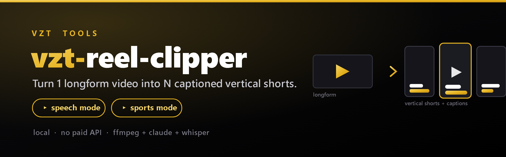

<p align="center">
  
</p>

<p align="center">
  <a href="#">= 20"></a>
  <a href="LICENSE"></a>
  <a href="#"></a>
  <a href="#"></a>
</p>

# vzt-reel-clipper

Local AI agent that turns **1 longform video → N captioned vertical shorts** — the thing those "AI clips agent" reels are selling, except it runs on your own machine with **no paid API**. Transcription is local; moment selection runs through your **`claude` *or* `codex` CLI** subscription (`--engine`, default `claude`).

**Three selection modes:**

| mode | for | how it picks moments | captions |
|---|---|---|---|
| `speech` *(default)* | podcasts, talking-head, lessons | transcript → `claude` picks best spoken moments | animated word-by-word |
| `sports` | game film (raw sideline / phone-from-stands) | **audio-energy peaks** (crowd, contact, whistles) | "Big Play N" banner |
| `hype` | game film → **one** music-driven reel | motion + audio + CLIP context, cut to the beat of your track | none (music-driven, not talking-head) |

Both `speech` and `sports` reframe to **9:16 (1080×1920)** — center-crop by default, or **subject-tracking pan & scan with `--fit smart`** (follows the person, frames between two people, letterboxes wide shots, holds during silence) — burn captions with ffmpeg, write a `clips.json` manifest, and can stitch a highlight reel with `--reel`. `hype` mode always outputs vertical 9:16 and produces a single finished reel instead of N clips — see [Hype mode](#hype-mode) below.

## Contents

- [Requirements](#requirements)
- [Install](#install)
- [How to use](#how-to-use) · [full step-by-step guide ›](docs/HOW-TO-USE.md)
- [Usage](#usage)
- [Sports mode](#sports-mode)
- [Hype mode](#hype-mode)
- [Watch a video](#watch-a-video)
- [Learn an editing style](#learn-an-editing-style)
- [Apple Music](#apple-music)
- [YouTube input](#youtube-input)
- [Options](#options)
- [Output](#output)
- [How it works](#how-it-works)
- [Limitations](#limitations)

## Requirements

| tool | needed for |
|---|---|
| **ffmpeg** | bundled via `ffmpeg-static` (ships libass, so captions burn anywhere) — no install needed; override with `VZT_FFMPEG` |
| **ffprobe** (on PATH) | media duration/size probing — override with `VZT_FFPROBE` |
| **node ≥ 20** | the CLI |
| **claude** *or* **codex** CLI (logged in) | speech-mode moment selection (`--engine`); also drives `reelclip watch`'s and `reelclip learn`'s vision pass (`claude -p`, not `--engine`-selectable) |
| **vintel** (`vzt-video-intel`) CLI | **required** for speech-mode local transcription (first run downloads a ~75 MB Whisper model). **Optional** for hype mode — an on-PATH `vintel` adds CLIP semantic search for B-roll/highlight scoring; without it, hype mode degrades gracefully to motion+audio scoring. |
| **onnxruntime-node** (optional npm dep) | only `--reframe-backend onnx` (local YOLOv8 person detection, for talking-head footage); the default `motion` backend needs no model and no extra dependency |
| **your own audio** (music + sfx) | hype mode — see [Hype mode](#hype-mode); nothing copyrighted ships with the repo |
| **yt-dlp** + **deno** | only the YouTube input path |

Sports mode needs only node + ffprobe (ffmpeg is bundled).

## Install

```bash
git clone https://github.com/vonzelle-vzt/vzt-reel-clipper.git
cd vzt-reel-clipper
npm install
npm link        # optional — puts `vzt-reel-clipper` (and `reelclip`) on PATH
npm test        # optional — self-contained smoke tests (41 tests)
```

## How to use

> 📖 **New here?** This is the short version — the full hand-holding walkthrough
> (with troubleshooting) lives in **[docs/HOW-TO-USE.md](docs/HOW-TO-USE.md)**.

**Step 1 — sanity check** (after install):

```bash
vzt-reel-clipper --version     # 0.1.0
vzt-reel-clipper --help        # every option
```

**Step 2 — pick the mode that matches your footage:**

- **`speech`** *(default)* — anything with talking: podcasts, interviews,
  lessons, talking-head reels. It reads the words and picks the best moments.
- **`sports`** — game film with little/no speech (raw sideline, hudl, phone from
  the stands). It finds the action by **loud moments** (crowd, contact, whistles).

**Step 3 — run it:**

```bash
# Talking video → 5 captioned vertical shorts in ./clips
vzt-reel-clipper "C:\Users\neilv\Videos\podcast.mp4"

# Game film → big-play shorts + one stitched highlight reel
vzt-reel-clipper "C:\film\full-game.mp4" --mode sports --reel
```

It prints the clips it chose, then drops finished `.mp4`s (ready for
TikTok/Reels/Shorts) plus a `clips.json` manifest into the output folder.

**Tuning, in one line each:**

```bash
vzt-reel-clipper video.mp4 -n 8 --min 20 --max 45 --font Impact   # speech: more/shorter clips, font
vzt-reel-clipper game.mp4 --mode sports --sensitivity 0.7         # sports: quiet film → more clips
vzt-reel-clipper game.mp4 --mode sports --preroll 8 --postroll 5  # sports: widen the play window
vzt-reel-clipper video.mp4 --engine codex                        # use Codex (GPT) instead of Claude
vzt-reel-clipper "https://youtu.be/XXXX" --cookies-from-browser firefox   # from a YouTube link
```

**Choosing the brain (`--engine`):** moment selection runs through whichever CLI
you're logged into — `claude` (default) or `codex`. Both use your existing
subscription, so neither adds an API bill. Sports mode doesn't call an LLM at
all, so `--engine` only matters in speech mode.

> Stuck? See the [troubleshooting table](docs/HOW-TO-USE.md#6-troubleshooting).

## Usage

```bash
# Local file → 5 captioned shorts into ./clips
vzt-reel-clipper "C:\path\to\lecture.mp4"

# Pick how many, set length bounds, choose font, output dir
vzt-reel-clipper lecture.mp4 -n 8 --min 20 --max 50 --font "Impact" -o out/

# Just cut + reframe, no captions
vzt-reel-clipper lecture.mp4 --no-captions

# GAME FILM → big-play shorts + a stitched team highlight reel
vzt-reel-clipper "C:\film\full-game.mp4" --mode sports -n 8 --reel

# YouTube (needs cookies — see below)
vzt-reel-clipper "https://www.youtube.com/watch?v=XXXX" --cookies-from-browser firefox
```

> `reelclip` is a shorter alias for the same command.

## Sports mode

Game film has no usable speech, so `--mode sports` ignores transcripts and finds
the action by **audio loudness peaks** (ffmpeg `ebur128`) — crowd reaction,
contact, and whistles all spike the audio. Each peak becomes a clip starting
`--preroll` seconds *before* the spike (to catch the snap/buildup) and ending
`--postroll` after.

```bash
vzt-reel-clipper game.mp4 --mode sports --reel            # clips + one team reel
vzt-reel-clipper game.mp4 --mode sports --sensitivity 0.7 # quieter film → more clips
vzt-reel-clipper game.mp4 --mode sports --preroll 8 --postroll 4
```

- **Phone-from-stands** film works best (loud crowd). **Raw sideline** film works
  off contact/whistle spikes — lower `--sensitivity` (e.g. `0.7`) if it finds too few.
- `count` is a **maximum** — weak peaks are dropped, so a quiet game yields fewer
  *real* clips rather than padding the reel with non-plays.
- `--reel` concatenates the clips into one `00-highlight-reel.mp4`.
- This is **not** per-athlete recruiting reels — that's player tracking (a job for
  [NextPlay](https://nextplay)-style vision pipelines), not generic clipping.

## Hype mode

`--mode hype` produces **one music-driven vertical reel** instead of N standalone
clips — cuts land on the beat, the best play lands on the drop, and the pacing
follows a build/break/rebuild arc instead of a flat sequence of highlights. It's
the "edit to your music" style you'd cut by hand, automated.

You supply the audio — nothing copyrighted ships with the repo. Lay out a small
library on disk:

```
~/vzt-audio/music/track.mp3          → --music
~/vzt-audio/sfx/whoosh/*.wav         → --sfx-dir ~/vzt-audio/sfx
~/vzt-audio/sfx/impact/*.wav
~/vzt-audio/sfx/riser/*.wav
```

`--sfx-dir` points at the *root* of the library; the `whoosh/`, `impact/` and
`riser/` subfolders are scanned per-category and a sample is picked per cue. Any
category folder can be missing or empty — cues with no sample are simply
skipped, so the reel builds fine with partial or no sfx.

**Worked example:**

```bash
reelclip game.mp4 --mode hype --sport basketball \
  --music ~/vzt-audio/music/track.mp3 --sfx-dir ~/vzt-audio/sfx
```

**How it picks and cuts:** `analyzeMusic` (`src/music.js`) derives a beat grid
and (if present) the bass drop from the track itself — no manual tagging.
`scorePlays` (`src/score.js`) blends motion, audio loudness and (when `vintel`
is available) CLIP semantic hits for the chosen `--sport`'s highlight
vocabulary into a single score per moment, and rejects "loud but still"
dead-ball moments. `planEdit` (`src/plan.js`) lays out the edit as data: a short
B-roll intro, the best play on the drop, an alternating action/B-roll body
following a pacing arc, and an outro — all sized in whole beats so cuts land on
the grid by construction. `composite.js` renders it in one pass: framing, color
grade, speed ramps into the scored peak, transitions, an SFX mix, and two-pass
loudness normalization to -14 LUFS.

`scorePlays` also drops a **silent-but-present audio track** rather than
scoring it — a track with no real sound still produces a flat loudness curve,
which normalizes to a constant that dilutes every score while looking like
real data (detected as nothing above -70 LUFS, or under 1.0 LU of range). And
`minGap` (how far apart plays must be) scales down for short source material —
a sport profile's gap assumes raw, uncut game film, and applying it unscaled to
a short highlight tape caps the reel at a handful of plays regardless of how
much action is in it; it is never scaled *above* the profile's own value.

Two consecutive action shots are joined with a **whip-pan transition**
(`smoothleft`/`smoothright` xfade, 0.15s, paired with a whoosh cue) when both
travel in the same direction above a minimum threshold — `score.js` measures
each play's direction of travel over a tight window around its peak. Locked-off
tripod footage where nothing moves correctly never gets a whip; it's a hard cut
on the beat instead. This matches direction of travel, not action — true
match-cuts between similar plays are not implemented.

The reel is also **gapless**: the B-roll intro runway is sized in beats up to
the drop, but can only be filled if B-roll candidates exist. `plan.js` shifts
the whole timeline to start at zero and offsets the music track by the same
amount, so the hook still lands exactly on the drop with no dead air at the
open.

**Supported `--sport` profiles** (`src/profiles.js`): `basketball`, `football`,
`flag-football`, `soccer`, `lacrosse`, `baseball`, `softball`, `volleyball`,
`hockey`, `wrestling`, `track`, `tennis`, `generic` (default — used for any
unrecognized or omitted `--sport`).

**Hype-mode options:**

| flag | default | meaning |
|---|---|---|
| `--sport <name>` | `generic` | sport profile — sets highlight/B-roll vocabulary and play-window timing |
| `--music <file>` | — | **required** for `--mode hype` — the track that drives the edit |
| `--sfx-dir <dir>` | — | root of your sfx library (`whoosh/`, `impact/`, `riser/` subfolders) |
| `--grade <name>` | `punch` | color grade: `none`, `punch`, `teal-orange`, `film` |
| `--lut <file.cube>` | — | 3D LUT to apply instead of a named grade (overrides `--grade`) |
| `--arc <name>` | `rollercoaster` | pacing arc: `rollercoaster` (build/break/rebuild), `build` (monotonic acceleration), `steady` |
| `--duration <sec>` | — | cap the reel length |
| `--no-ramps` | off | don't speed-ramp into the moment of impact |
| `--no-sfx` | off | don't mix sound effects |
| `--ambience <0..1>` | `0.18` | how much source (game) audio sits under the music |
| `--style <name>` | — | cut in a style learned with `reelclip learn` — see [Learn an editing style](#learn-an-editing-style) |
| `--apple-music <query>` | — | resolve tempo from an Apple Music preview instead of `--music`/`--bpm` — see [Apple Music](#apple-music) |
| `--drop-from-music` | off | read the drop from the Music app's current playhead instead of `--drop` — see [Apple Music](#apple-music) |

`--fit` and `--reframe-*` still apply to hype mode's framing (default `cover`).
`--fit smart` plans a camera path **per shot**: each shot in the EDL gets its
own `planReframe` call over its own source window, and any shot whose path
can't be planned safely falls back to letterboxing (or centre-crop) for that
shot alone rather than dragging the whole reel down to one fit. `-n/--count`
still bounds how many candidate plays are scored (raised to at least 10
internally in hype mode so the planner has enough material to build a full arc
from).

**Output:**

```
clips/
  00-hype-reel.mp4          # the finished reel
  cover.jpg                 # cover frame — the hook shot on the drop
  edl.json                  # the edit decision list plan.js built (for inspection/reuse)
```

## Watch a video

Before tuning any selection flag, look at what's actually in the footage.
`reelclip watch <video|url>` samples frames, hands their **paths** to `claude
-p` (which `Read`s them — genuinely watching, not statistics dressed up as
insight), and fuses the labels with independently measured motion, cuts and
audio into one timeline. The mechanism is ported from `vzt-reel-studio`,
which already proved it in that fleet.

```bash
reelclip watch game.mp4
reelclip watch game.mp4 --density detail --sport football
reelclip watch game.mp4 --no-describe   # measurement only, zero tokens
```

Frames are labelled in batches (~20 frames per `claude -p` call, bulk
labelling on `haiku`) against a **closed-enum** schema — `action | broll |
celebration | crowd | unclear` — so the answer can be counted, not just read.

**`--density`** sets the sampling rate. A 512px frame costs ~197 vision
tokens, so cost scales linearly with frame count:

| density | fps | example cost |
|---|---|---|
| `skim` | 0.5 | a 64s clip ≈ 6k vision tokens |
| `normal` *(default)* | 1 | a 4-minute video ≈ 47k vision tokens |
| `detail` | 2 | ~2× `normal` |
| `forensic` | 4 | ~4× `normal` |

`--no-describe` skips the vision pass entirely — measurement only (motion,
cuts, tempo), zero tokens.

**Output** (`--out`, default `watch/`): `watch.json` (the fused timeline —
per-frame label, motion, `ballVisible`, plus cuts and music), a contact
sheet, the label mix, and the ranges where live action was found.

**What this catches:** on real 7-on-7 game film, `watch` reported **25%
action / 69% b-roll** — versus **13% action** on a warm-up file from the same
session. That discrimination is the whole point: it tells playable game film
from a session with no live reps in it, before a single clip gets cut.

**Honest limits:**
- **Sampling, not continuous.** An event that falls entirely between two
  frames is missed — raise `--density` if that matters.
- **Audio is analysed and transcribed, not heard.** Loudness and tempo feed
  the measurement half of the timeline; a whistle or crowd roar shows up as a
  motion/loudness signal, not as a labelled sound event.

## Learn an editing style

Point `reelclip learn <url|file> --name <style>` at an edit someone already
cut well and it reverse-engineers the grammar into `src/styles/<name>.json`:
BPM, the percentage of cuts landing on-beat (reported against a **chance**
baseline, not the raw number alone), shot-length percentiles (in seconds and
in beats), the best-fit pacing arc, ramp fraction, action %, and grade
saturation.

```bash
reelclip learn "https://youtu.be/XXXX" --name roundtrip --sport football
reelclip styles                                            # list what's been learned
reelclip game.mp4 --mode hype --style roundtrip --music track.mp3
```

The downloaded reference video is **deleted** once measured — only the
numbers and one contact sheet are kept.

`--style` maps onto the same options `planEdit` already accepts (`arc`,
`minShotBeats`, `rampCount`, `grade`). **An explicit CLI flag you type always
beats the learned style**, and the run prints where each value came from:

```
style "roundtrip" → arc:flag minShotBeats:style rampCount:style
```

Two honesty behaviours worth knowing:

- **Beat alignment is reported against a chance baseline.** At 120 BPM with a
  ±60ms tolerance window, a *random* cut lands "on beat" about 24% of the
  time — so the raw on-beat percentage alone is misleading; `learn` reports
  it alongside `chance` and the `lift` over it.
- **A weak arc fit is reported as one.** When the best-fitting arc's
  correlation is below 0.4, the tool says "no clear shape" and falls back to
  the neutral `steady` arc instead of asserting a shape it did not really
  detect.

**Known limitation:** shot-boundary detection misses cuts between visually
similar shots. A round-trip on the project's own 9-shot reference reel
recovered 7 of 9 shots.

## Apple Music

Apple Music subscription files are DRM-protected, and this tool never tries
to circumvent that. Instead `--apple-music`, `music search` and `music now`
pull the two numbers a hype edit needs from sources that are legitimately
reachable:

- **Tempo** — the public iTunes Search API returns a DRM-free 30-second AAC
  preview for almost every catalog track, which is plenty of audio for
  `music.js`'s onset/tempo estimator to lock onto a BPM.
- **Drop** — read from the Music app's own player position via AppleScript:
  scrub the real track to the drop, then run the command.

```bash
reelclip music search "dreams and nightmares meek mill"
reelclip music now                                   # currently playing + position
reelclip game.mp4 --mode hype --sport football \
  --apple-music "dreams and nightmares meek mill" --drop-from-music
```

- **Octave warning.** A 30-second excerpt commonly reads at double the real
  tempo — measured 198.8 BPM on a track that's actually about half that.
  Anything above ~175 BPM (or below ~70) triggers a warning suggesting
  `--bpm` to override.
- **The preview's own "drop" is discarded.** It's a mid-track excerpt, so any
  drop `music.js` finds inside it has nothing to do with the full song's
  timeline. The real drop only comes from `--drop <sec>` or
  `--drop-from-music`.
- **`--apple-music` conflicts with `--music` and `--bpm`** — pass exactly one
  tempo source. Like `--bpm`, it produces a silent master (there's no
  full-length file to mix in), so it pairs with `--no-music-bed` for the
  workflow where you cut to the beat and add the official track back in the
  TikTok/Reels editor.

## YouTube input

YouTube now (a) requires a JavaScript runtime and (b) bot-checks downloads, so the
YouTube path needs **deno** (auto-detected from `~/.deno/bin`) **and browser cookies**:

- **Easiest on Windows:** `--cookies-from-browser firefox` (Firefox cookies aren't DPAPI-encrypted).
- **Edge / Chrome** cookie decryption often fails with `Failed to decrypt with DPAPI`
  (Chromium app-bound encryption). Close the browser first, or export a `cookies.txt`
  ("Get cookies.txt" extension) and pass `--cookies cookies.txt`.

Geo-blocked or IP-throttled? Route the download through any proxy with
`--proxy <url>` (forwarded verbatim to yt-dlp; only the download uses it —
everything downstream runs locally).

The **local-file path has none of this friction** — download a video however you
like, then point the tool at the file.

## Options

| flag | default | meaning |
|---|---|---|
| `-m, --mode <mode>` | `speech` | `speech`, `sports`, or `hype` (see [Hype mode](#hype-mode) for its own option table) |
| `-n, --count <n>` | 5 | number of clips (a **max** in sports mode; a candidate-play floor in hype mode) |
| `-o, --out <dir>` | `clips` | output directory |
| `--reel` | off | also stitch clips into one highlight reel |
| `--min / --max <sec>` | 18 / 60 | clip length bounds *(speech mode)* |
| `--preroll / --postroll <sec>` | 7 / 4 | seconds around each peak *(sports mode)* |
| `--sensitivity <n>` | 1.0 | peak threshold *(sports mode; lower = more clips)* |
| `-l, --language <iso>` | auto | transcription language hint |
| `-e, --engine <name>` | `claude` | LLM for moment selection: `claude` or `codex` |
| `--model <name>` | engine default | model override (claude → `sonnet`; codex → its config default) |
| `--font <name>` | `Arial` | caption font |
| `--fit <mode>` | `cover` | framing: `cover` (crop) / `contain` (pad) / `blur` / `smart` (subject-tracking) |
| `--reframe-backend <name>` | `motion` | smart detector: `motion` (default, local, no model — follows motion, best for sports) / `onnx` (local YOLOv8 person detection) / `vintel` (cloud) / `mock` |
| `--reframe-model <path>` | — | YOLOv8 `.onnx` for the `onnx` backend (or set `VZT_REFRAME_MODEL`) |
| `--reframe-letterbox <fit>` | `blur` | fit for clips too wide to pan (`blur` / `contain` / `cover`) |
| `--no-reframe-audio-hold` | off | smart: don't hold the camera during silence |
| `--no-reframe-active-speaker` | off | smart: letterbox wide two-shots instead of following the talker |
| `--no-captions` | off | skip burned-in captions |
| `--cookies <file>` | — | cookies.txt for YouTube |
| `--cookies-from-browser <b>` | — | firefox / edge / chrome |
| `--proxy <url>` | — | proxy for the yt-dlp download only (`http://` / `socks5://`, creds ok) |
| `-v, --version` | | print version |

> Smart-reframe also takes `--reframe-smooth`, `--reframe-deadzone`,
> `--reframe-fps` and `--reframe-conf` for fine tuning — see `--help` and
> [docs/HOW-TO-USE.md#framing---fit](docs/HOW-TO-USE.md#framing---fit).

## Output

```
clips/
  00-highlight-reel.mp4     # only with --reel
  01-<hook-title>.mp4
  02-<hook-title>.mp4
  …
  clips.json                # manifest: start/end, titles, selection reasons
```

`--mode hype` writes a different, single-reel layout instead — see
[Hype mode](#hype-mode)'s Output section.

## How it works

```
                        ┌──────────── speech mode ────────────┐
input ─▶ resolve ─▶  ┤                                          ├─▶ render ─▶ clips/*.mp4
        (file/URL)    │  transcribe ─▶ select (claude)          │   (ffmpeg)   (+ reel)
                      └──────────── sports mode ────────────────┘
                         detect audio-energy peaks (ebur128)
```

- **Word-level captions:** YouTube auto-subs carry true per-word timing. Local
  transcription is segment-level, so word times are interpolated within each
  segment (good enough for the karaoke highlight; swap in a word-level ASR for
  frame-perfect timing).
- **Caption style** lives in `src/ass.js` (font, size, colors, highlight scale,
  lower-third position) — tweak there.
- **Smart reframe** (`--fit smart`, `src/reframe.js`): samples the clip, detects
  the subject, plans a smoothed virtual-camera path and drives ffmpeg's `crop`
  via `sendcmd` in the single render pass — framing between people, letterboxing
  wide shots, snapping at cuts, holding in silence. Falls back to center-crop
  whenever a path can't be planned. The default `motion` backend
  (`src/detect/motion.js`) tracks frame-to-frame motion instead of detecting
  people — on wide team-sport film with a dozen-plus players spread across the
  frame, person detection's salient union spans the whole picture and can't be
  panned, so `motion` follows the busiest column of movement instead. It needs
  no model and no extra dependency. The `onnx` backend (local YOLOv8 person
  detection — the right subject for a talking head) needs the optional
  `onnxruntime-node` package (not installed by default — `npm i
  onnxruntime-node` — everything else in the tool works without it).

Full data flow and the ffmpeg/ASS gotchas are documented in
[`docs/ARCHITECTURE.md`](docs/ARCHITECTURE.md).

## Limitations

- Sports mode finds *that* a big moment happened, not *who* made the play — it
  can't yet frame on a specific player or read the scoreboard.
- Reframing defaults to a center-crop (`--fit cover`). For subject-tracking pan
  & scan use **`--fit smart`** — it follows the subject (framing *between* two
  people when they fit, following the **talker** in a wide two-shot, letterboxing
  when it can't tell who's speaking, hard-cutting at edits, and holding during
  silence). Smart mode needs a detector backend — `motion` (default, tracks
  movement, no model needed, best for sports) or the person-detecting `onnx`
  (local YOLOv8) / `vintel` (cloud), which suit a talking head; without a
  working backend it transparently falls back to center-crop. See
  [Framing](docs/HOW-TO-USE.md#framing---fit) in the guide. The active-speaker
  pick is a **mouth-motion proxy** (gated by audio), not true audio-visual
  lip-sync — disable with `--no-reframe-active-speaker`.
- Local caption timing is interpolated (see above).

## Built on the VZT stack

Reuses the pure-WASM Whisper backend from
[`vzt-video-intel`](https://www.npmjs.com/package/vzt-video-intel) and the `claude`
CLI subscription pattern from `tele-build-agent` — so it adds a capability without
adding a bill.

## License

[MIT](LICENSE) © VZT (vonzelle)
